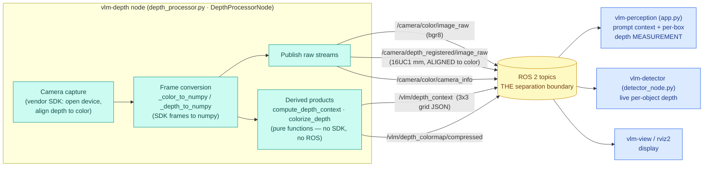
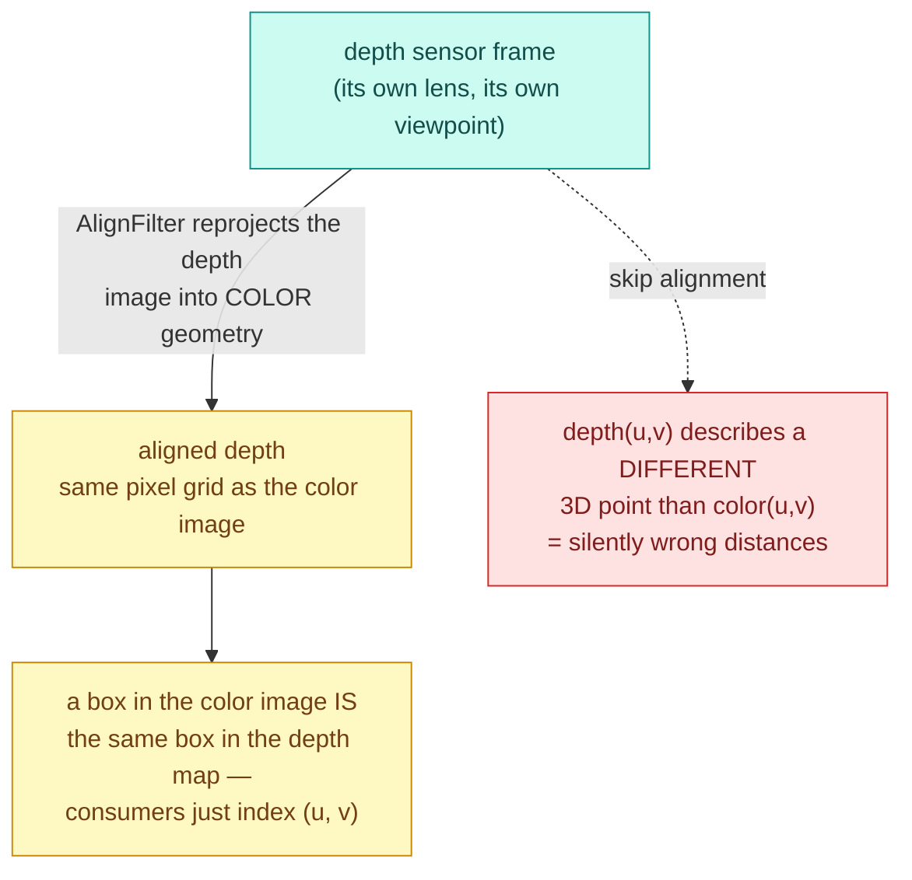
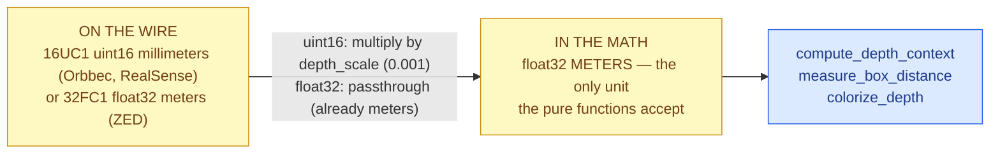
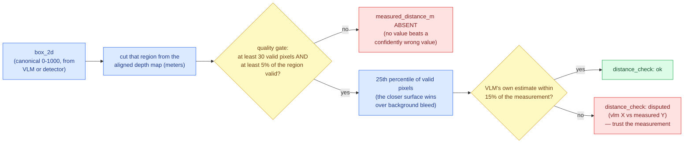
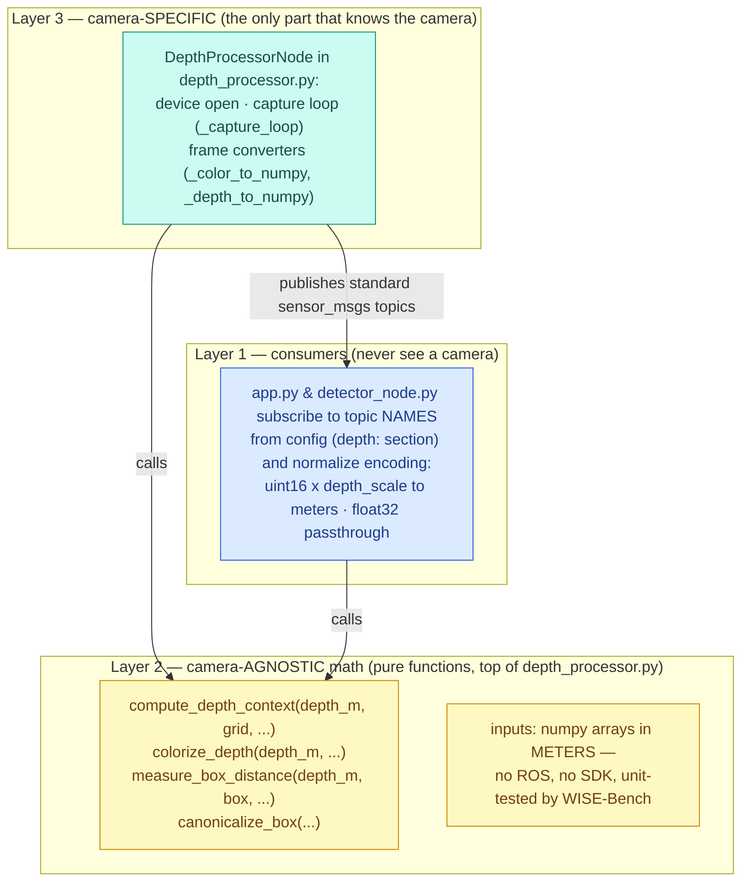
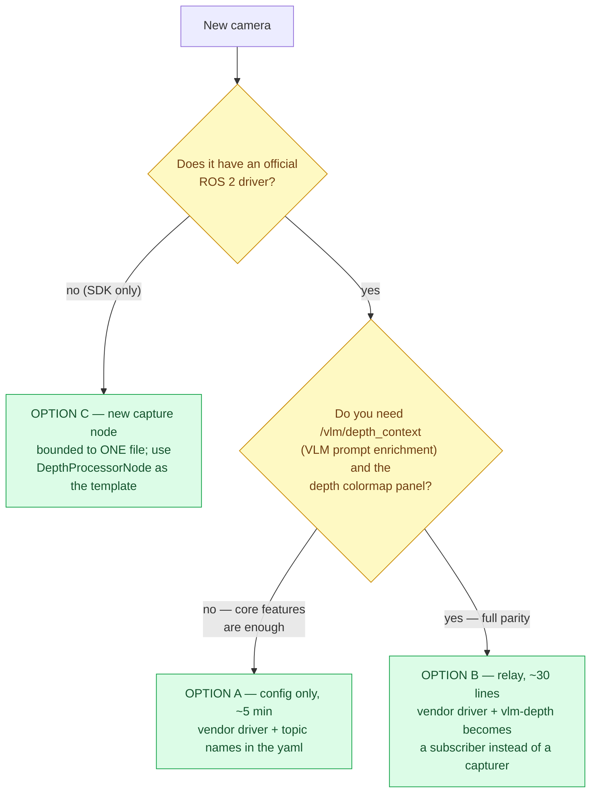
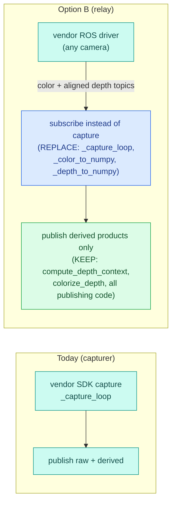
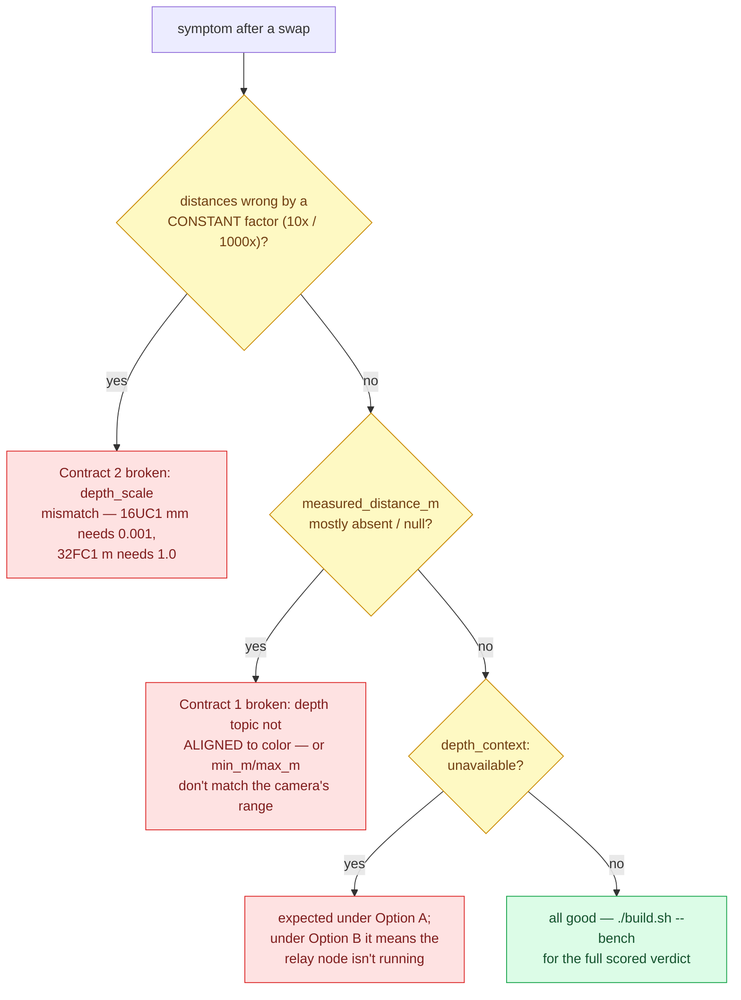

# Depth Camera Integration — How It Works and How to Swap Cameras

This is a developer guide to the camera boundary: how the depth camera is wired into the pipeline, where the **separation boundaries** are (with exact file/function anchors in the shipped code), and precisely what to change to run a different depth camera — ZED, RealSense, or any other — **without rewriting the application**. The pipeline is modular by design: the camera is a swappable supplier behind a topic boundary. Camera SDK specifics are deliberately out of scope; what matters here is the architecture that makes them replaceable.

Color code used by every diagram below: **teal** = the only camera-aware code, **blue** = camera-agnostic consumers, **yellow** = the contracts that must hold, **green** = what you keep or configure, **red** = what goes wrong when a contract is broken.

---

## 1. The current pipeline in detail



**How to read it:** everything teal knows about the camera; everything blue only knows topic names from the config. The yellow cylinder is the entire coupling between them — swap anything on the teal side and the blue side cannot tell the difference.

What each consumer takes from the boundary:

| Consumer | Subscribes to | Uses it for |
|---|---|---|
| `vlm-perception` | color, aligned depth, `/vlm/depth_context` | the frame sent to the VLM; a text grid of distances added to the prompt; **measuring** each returned box against the depth map and fact-checking the VLM's distance estimates |
| `vlm-detector` | color, aligned depth | real-time inference input; live measured distance per tracked object |
| `vlm-view` / rviz2 | color (+ colormap, annotated) | display |

### 1.1 The two contracts every camera must honor

**Contract 1 — depth is ALIGNED to color.** Alignment happens at the source: the camera node publishes depth already registered to the color frame, so every consumer can index the depth map with color-pixel coordinates directly.



Every vendor ROS driver offers an "align depth to color" mode — turning it on is the single most important step of any camera swap.

**Contract 2 — wire units vs math units.** The ROS wire carries whatever the camera family prefers; the math accepts exactly one unit, and the conversion happens once, at the subscription boundary:



Both consumers already implement both branches — that's why a ZED (float meters) and a RealSense (uint16 millimeters) both work with only config changes.

Two more properties worth knowing:

- **Latest-wins everywhere.** No queues; consumers keep only the newest frame. A slow consumer never builds up lag.
- **QoS is swap-friendly.** The consumers subscribe with the best-effort sensor-data profile, which connects to both reliable publishers (the shipped `vlm-depth`) and the best-effort publishing most vendor drivers default to — no QoS surgery needed for Option A below.

### 1.2 Depth is measured, never trusted

The VLM guesses distances; the depth map decides. This flow runs per object, per cycle, in the consumers — not in the camera node, which is why it survives any camera swap:



Example from a live run: the model estimated 1.8 m / 3.0 m for objects measured at 0.9 m / 2.1 m — both mismatches were flagged as disputed. The thresholds (`bbox_percentile: 25`, `distance_tolerance_pct: 15`, `min_m`/`max_m`) all live in the `depth:` config section.

## 2. The separation — three layers, with exact code anchors

The camera dependency is isolated behind **three layers** in the shipped source:



| Layer | Where | Camera-specific? |
|---|---|---|
| Consumers (`app.py`, `detector_node.py`) | subscribe to `depth.color_topic` / `depth.depth_topic` / `depth.camera_info_topic` **from the config** — never a device | **No** — and both already handle `16UC1` (uint16 × `depth_scale`) *and* `32FC1` (float meters) encodings, the two conventions used across the camera industry |
| Pure functions (top of `depth_processor.py`) | depth-context grid, colormap, box measurement — operate on numpy arrays in meters | **No** — exercised directly by WISE-Bench's unit battery |
| `DepthProcessorNode` (rest of `depth_processor.py`) | device open, capture loop, SDK-frame→numpy conversion, publishing | **Yes — this is the only camera-aware code in the entire bundle** |

One nuance to know before swapping: the camera node currently does **two jobs** — capturing (camera-specific) *and* publishing the derived products (`/vlm/depth_context`, colormap — computed by the pure functions). That defines the one optional code touchpoint described in Option B below.

## 3. Swapping the camera

Three options, in rising order of effort. Pick yours in ten seconds:



Whichever you pick: description/OCR/boxes, real-time detection, and per-object **measured** distances survive unchanged — those live in the blue layers, behind the topic boundary.

### Option A — vendor ROS driver + config only (no code, ~5 minutes)

Every major depth camera ships an official ROS 2 driver that publishes exactly the topic types this pipeline consumes. Run that driver instead of `vlm-depth` and point the config at its topic names.

**Step 1 — config** (`config/vlm_app.yaml`, `depth:` section). Typical values:

| Key | RealSense (aligned mode) | ZED (registered depth) |
|---|---|---|
| `color_topic` | `/camera/camera/color/image_raw` | `/zed/zed_node/rgb/image_rect_color` |
| `depth_topic` | `/camera/camera/aligned_depth_to_color/image_raw` | `/zed/zed_node/depth/depth_registered` |
| `camera_info_topic` | `/camera/camera/color/camera_info` | `/zed/zed_node/rgb/camera_info` |
| `depth_scale` | `0.001` (16UC1 millimeters) | `1.0` (32FC1 meters — the float path ignores scale automatically) |
| `min_m` / `max_m` | per the camera's rated range | per the camera's rated range |

*(Exact topic names vary by driver version and namespace — check with `ros2 topic list` once the driver runs. The requirement that never changes: the depth topic must be **aligned/registered to color** — Contract 1.)*

**Step 2 — launch.** In `launch/perception.launch.py`, remove (or comment) the `vlm-depth` node entry and the two static-TF publishers, and start the vendor driver alongside instead (its own launch file, with its "align depth to color" option enabled). Everything else launches unchanged.

**Step 3 — verify** (section 4).

**What you get / what you lose with Option A:**

| Capability | Status |
|---|---|
| VLM description, OCR, boxes | ✅ unchanged |
| Real-time detector with live per-object depth | ✅ unchanged |
| Per-object depth **measurement** + fact-check in payloads | ✅ unchanged (computed by the consumers, not the camera node) |
| Depth-context grid in the VLM prompt (`/vlm/depth_context`) | ⚠️ absent — the app marks depth context "unavailable" and continues; only the prompt enrichment is lost |
| Depth colormap display panel | ⚠️ absent (use the vendor driver's own depth visualization in rviz instead) |

### Option B — full parity: adapt the camera node into a relay (~30 lines)

To keep the depth-context grid and colormap with a vendor driver, convert `DepthProcessorNode` from *capturer* to *relay*: replace the capture loop with subscriptions, keep all the math.



- **Replace** (teal becomes blue): the constructor's device-open section,
  `_capture_loop`, and the two SDK-frame converters — with two
  `create_subscription` callbacks (color, aligned depth) that convert via
  `cv_bridge` and normalize depth to meters (Contract 2, same rule the consumers use).
- **Keep untouched** (green): `compute_depth_context`, `colorize_depth`, the throttled publishing of `/vlm/depth_context` and the colormap, and all configuration handling.
- The raw-stream publishing disappears (the vendor driver owns those topics).

### Option C — write a new capture node for an SDK-only camera

If your camera has no ROS driver, write a minimal node that does what `DepthProcessorNode`'s capture side does: grab color + depth, **align depth to color** (most SDKs provide this), convert to numpy, publish the three standard topics. Use the existing node as the template — its publishing half and all downstream behavior then work as-is. This is the only scenario requiring real new code, and it is bounded to one file.

## 4. Verifying a camera swap

```bash
# 1. The boundary topics exist and flow (names per your config):
ros2 topic hz /your/color/topic          # expect the camera's fps
ros2 topic hz /your/aligned/depth/topic  # expect the camera's fps

# 2. The full verification suite:
./build.sh --bench
#    → T3 "units: box canonicalize + depth" proves the math still holds;
#      a live payload check below proves the integration.
#    → the bench contains no camera-SDK checks at all: its depth checks are
#      the camera-agnostic pure-function units, so verdicts stay meaningful
#      with ANY camera or vendor driver.

# 3. One real payload — depth fields present and sane:
ros2 topic echo /vlm/perception --once
#    look for: "depth_context": "ok" (Option B) and per-object
#    "measured_distance_m" values matching reality.
```

When something looks off, walk the symptom tree — each red box is one of the two contracts from section 1.1 failing:



## 5. Design rationale (why it's built this way)

The topic boundary + pure-function core means the expensive, validated parts — box canonicalization, quality-gated measurement, the fact-check contract, the two-tier fusion — never change when hardware does. A camera swap is a supplier decision, not a re-engineering project: Option A is a config edit, Option B is one file, and nothing downstream ever knows the difference.

For the full application architecture around this boundary — every node, topic, payload contract, and how to extend the pipeline — see the developer guide at `weda_ws/src/vlm_perception/README.md`.
