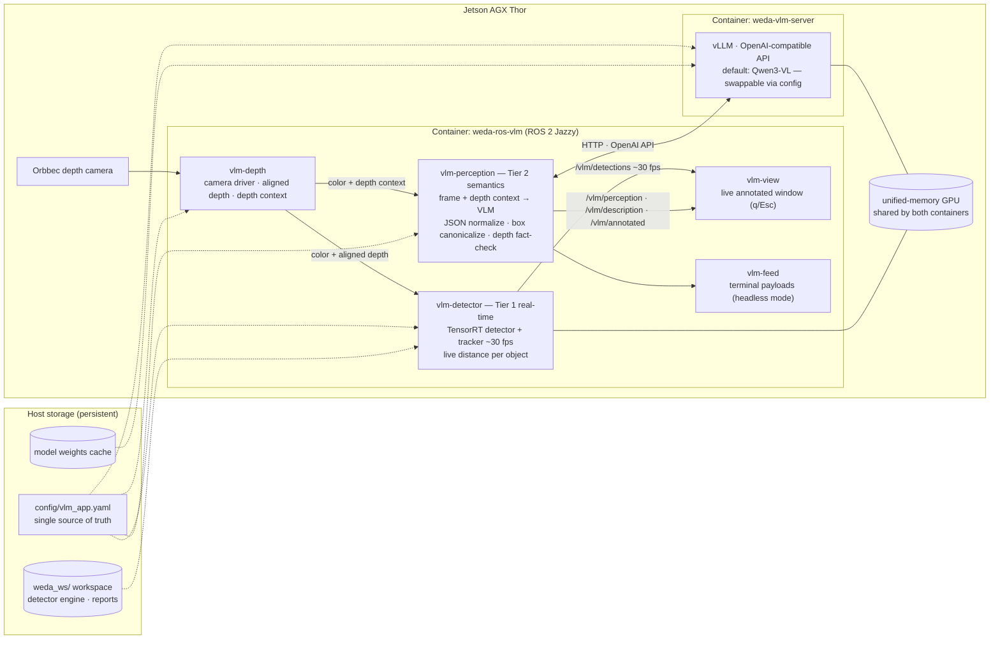

# WEDA ROS VLM — Vision Language Model Perception Container

The **WEDA ROS VLM** bundle turns an NVIDIA Jetson AGX Thor into an industrial vision-language perception system: a live camera feed is described, read (OCR), and measured in real time — structured JSON on ROS 2 topics, a live annotated display, and a single configuration file driving everything. It ships as a ready-to-run container pair (ROS application + VLM server) with a complete, documented reference application intended to be extended into your own product.

## Container Features

| Feature | What it does (one line) |
|---|---|
| Two-tier perception | A TensorRT detector tracks objects at ~30 fps while the VLM adds meaning every few seconds — fused live by overlap. |
| Scene description | The VLM describes the scene and ongoing actions in natural language, updated every cycle. |
| OCR (visible text) | Any readable text in view is transcribed verbatim into the payload. |
| Measured depth fact-check | Every object box is measured against the aligned depth map; the VLM's distance guess is published beside the measurement and flagged when they disagree. |
| Real-time annotated display | A large live window renders the camera stream with boxes, distances, labels, and the full response text. |
| Streaming early response | The description appears seconds before the full analysis completes (streamed as soon as its field closes). |
| Model swapping | Any VLM your vLLM build supports can be served — a 3-line config change; the client adapts to box formats and reasoning styles automatically. |
| One config file | Model, engine tuning, camera, prompt, depth, detector, display windows, topics — all in `config/vlm_app.yaml`. |
| Display toggles | `display:` section switches rviz2, rqt_graph, and the annotated viewer on/off individually. |
| BYOL license gate | Commercially licensed components install only at container start after EULA acceptance — never shipped in images. |
| Shared base image | Runs on the common WEDA vision base image; bundle-specific pieces hydrate automatically at first start. |
| On-device engine build | The detector's TensorRT engine compiles on your device on first run and persists in the workspace. |
| WISE-Bench | One command verifies both containers end-to-end — GPU, ROS transport, camera, app units, live model round-trips. |
| Headless operation | No display → GUIs skip automatically; all topics keep streaming for remote/ROS-network consumers. |
| Clean shutdown | `q` / `Esc` (terminal or viewer window) stops everything and releases the camera, with confirmation. |

## Host Requirements

| Requirement | Details |
|---|---|
| Device | NVIDIA Jetson AGX Thor (JetPack 7.x) |
| Docker | Docker Engine 24+ with Compose v2; your user in the `docker` group |
| NVIDIA runtime | `nvidia` container runtime configured (`sudo nvidia-ctk runtime configure --runtime=docker`) |
| Disk | ≥ 40 GB free (base image ~9.5 GB + VLM server image + ~17 GB model weights on first server start) |
| Network | Internet for first start (image pull, runtime hydration, model download); offline afterwards |
| Display (optional) | X11 desktop session for the annotated window / rviz2 / rqt_graph — headless runs stream topics only |
| Camera (optional) | Orbbec depth camera on USB3 (see `DEPTH_CAMERA.md` for other cameras); without one, a synthetic test stream runs |
| Memory note | The VLM server reserves a fraction of TOTAL unified RAM (`gpu_memory_utilization`, default 0.30 ≈ 37 GB) which must be free when it starts |

## Project Directory

```
weda-ros-vlm/
├── config/vlm_app.yaml      # THE configuration file (server + all ROS nodes)
├── build.sh                 # device launcher (server / demo / bench / shell / down)
├── docker-compose.yml       # container pair definition (app + vlm-server)
├── entrypoint.sh            # startup: workspace build, license gate, hydration
├── launch_demo.sh           # demo orchestration (used by --demo)
├── Dockerfile               # OPTIONAL custom-image template (air-gapped fleets)
├── display/vlm_perception.rviz   # rviz2 preset (color | depth | annotated)
├── tests/                   # WISE-Bench verification suite (both containers)
├── weda_ws/                 # your colcon workspace (host-mounted, persistent)
│   └── src/vlm_perception/  # the reference application source
├── DEPTH_CAMERA.md          # depth camera integration & camera-swap guide
├── TROUBLESHOOTING.md       # every failure mode, step by step
└── README.md                # this file
```

## Quick Start

**Step 0 — make the scripts executable** (needed after unpacking the bundle):

```bash
chmod +x build.sh entrypoint.sh launch_demo.sh tests/*
```

**Step 1 — accept the license (optional but recommended).** The real-time detector tier uses a commercially licensed package that installs only after you accept its EULA. Edit `.env`:

```
ACCEPT_COMMERCIAL_EULA=true
```

Without it the stack runs in OSS-only mode: everything works except the ~25+ fps detector overlay.

**Step 2 — start the VLM server:**

```bash
./build.sh --server
```

**Step 3 — verify the deployment with WISE-Bench.** Before starting the
application, confirm the containers are perfectly configured — GPU access, ROS transport, camera driver, application units, and a live round-trip to the model server are all checked with a scored verdict:

```bash
./build.sh --bench
```

Expect `[SUCCESS]` for both containers. If anything is flagged, fix it first (see `TROUBLESHOOTING.md` — every check has a remedy) — a clean bench means the application will run without surprises.

**Step 4 — run the demo:**

```bash
./build.sh --demo
```

## Execution Steps and Expected Results

| # | Command | Expected result |
|---|---|---|
| 1 | `chmod +x build.sh entrypoint.sh launch_demo.sh` | silent success; `./build.sh --help` now prints usage |
| 2 | `./build.sh --server` | `vlm-server starting — watch: curl -sf http://127.0.0.1:8000/health`. **First boot downloads ~17 GB and compiles CUDA graphs — allow up to an hour**; later starts take a few minutes. Healthy when the curl returns `200`. |
| 3 | `./build.sh --bench` | Two scored checklists (ROS container, then server container), each ending `[SUCCESS] ... functionally verified`; reports in `weda_ws/reports/`. **Run this before the demo** — a clean verdict confirms the whole deployment is correctly configured. The first bench also performs the one-time container start (hydration lines, workspace build), and the license prompt appears here if you haven't pre-set `.env`. |
| 4 | `./build.sh --demo` (first run) | Demo banner: camera detected, pipeline launching, `windows per config: rviz=1 rqt_graph=1 viewer=1`. The detector's **first run exports a TensorRT engine (~3 min)** — the demo terminal announces it, progress is in the demo log, and live detector boxes appear once it completes. Later runs skip this. |
| 5 | demo running (with display) | Three windows: the **large annotated viewer** (live video, green real-time boxes with distances, yellow VLM boxes, full description + OCR text in the bottom banner), rviz2 (color / depth / annotated panels), rqt_graph. Terminal shows `Full responses appear IN the annotated window (terminal feed off).` |
| 6 | demo running (headless) | `No usable DISPLAY — running headless (topics only)`; terminal prints live JSON payloads instead; all topics stream for remote ROS viewers. |
| 7 | press `q` or `Esc` (terminal or viewer window) | `Shutting down demo...` → nodes exit cleanly → `Demo stopped — camera released.` |
| 8 | `./build.sh --down` | Both containers stopped and removed; workspace, engine, weights all persist on the host. |

**About the detector engine:** the `.pt` weights convert to a TensorRT `.engine` **automatically** on the detector's first run (FP16, built on your device, persisted in `weda_ws/models/`) — nothing to do. To convert manually or bring custom weights, see "Converting a detector `.pt` to a TensorRT engine" in the developer guide (`weda_ws/src/vlm_perception/README.md`).

## Architecture



**Two-tier by design:** a VLM needs seconds per analysis; industrial annotation needs 30 fps. Tier 1 (detector) owns real-time geometry — boxes that move with objects, stable track IDs, live measured distance. Tier 2 (VLM) owns meaning — description, OCR, semantic labels — fused onto the moving boxes by overlap.
Each tier fails independently: a server restart never stops tracking; a missing camera never stops the VLM (it describes the configured stream instead).

**Depth is measured, never trusted:** the VLM proposes distances; the node samples the aligned depth inside every returned box and publishes the measurement alongside the model's estimate, flagging disagreements (`distance_check: disputed`).

## Application Files Explained

| File (under `weda_ws/src/vlm_perception/`) | Role |
|---|---|
| `vlm_perception/app.py` | The perception node: grabs the latest frame, calls the VLM, streams the reply, normalizes/canonicalizes the JSON, measures depths, publishes all payloads. |
| `vlm_perception/depth_processor.py` | The camera node (drives the depth camera, publishes color/aligned-depth/CameraInfo/depth-context/colormap) plus the pure math functions — see `DEPTH_CAMERA.md`. |
| `vlm_perception/detector_node.py` | Tier-1 real-time detector: TensorRT inference + tracking at ~30 fps with per-object depth; auto-exports its engine on first run. |
| `vlm_perception/view.py` | The big annotated window: live video + two-tier overlay + full wrapped response banner; `f` fullscreen, `q`/`Esc` close. |
| `vlm_perception/feed.py` | Terminal pretty-printer of payloads (runs automatically in headless mode). |
| `vlm_perception/serve_vlm.py` | Reads the same YAML and launches the vLLM server with all tuning applied (prints the exact command — teach-by-example). |
| `vlm_perception/common.py` | Config loader with `${VAR}` environment interpolation. |
| `launch/perception.launch.py` | Launches camera TFs + depth node + detector + perception together. |

## The Config File (`config/vlm_app.yaml`)

Every section is documented in-place with comments — the file **is** the manual.
Summary of what lives where:

| Section | Controls |
|---|---|
| `server:` | Which VLM is served and every engine optimization (memory fraction, quantization auto-detect, KV cache, attention backend, speculative decoding, context length). Includes ready-made presets and `SWAP NOTE`s for changing models. |
| `client:` | How the ROS node talks to the server (URL, timeouts, decoding temperature, image resize/quality). |
| `stream:` | The RGB-only fallback video source (GStreamer pipeline) used when depth is disabled — test pattern, USB, RTSP, or file variants included as comments. |
| `perception:` | Analysis cadence, output token budget, and **the prompt itself** — editing the prompt is the primary customization path. |
| `model_profile:` | How to interpret the served model's output (box format auto-detection, reasoning-tag stripping, OCR expectation) — the per-model adaptation layer. |
| `depth:` | Camera topics, depth scale/range, the depth-context grid, per-object measurement tuning, fact-check tolerance. See `DEPTH_CAMERA.md`. |
| `detector:` | Tier-1 model/engine, confidence, class filter, fps cap, tracker. |
| `display:` | Which demo windows open — see below. |
| `output:` | Topic names for all published results. |

### Model swapping — supported VLM families

Swapping the served model is a 3-line config change in the `server:` section (the ready-made presets and `SWAP NOTE`s in the file walk you through it):

```yaml
server:
  model: Qwen/Qwen3-VL-8B-Instruct   # 1. the new model (HF repo or local path)
  kv_cache_dtype: auto               # 2. fp8 is validated for Qwen only
  attention_backend: null            # 3. flashinfer is validated for Qwen only
```

Then `docker restart weda-vlm-server` — the config is read once at engine start. The ROS side adapts automatically (`model_profile:` handles box formats and reasoning styles); no application code changes.

VLM families in this serving stack, as verified on Jetson AGX Thor:

| Model family | Sizes practical on Thor (122 GB unified) | Status |
|---|---|---|
| **Qwen 3 VL** | 2B–32B (dense + MoE) | ✅ shipped default (30B-A3B AWQ); validated live |
| **Qwen 2.5 VL** | 3B / 7B / 32B; 72B as AWQ only | ✅ supported (same architecture family validated) |
| **NVIDIA Cosmos-Reason1** | 7B | ✅ validated live — reasoning model: set `perception.max_tokens: 2048+` |
| **NVIDIA Nemotron Nano VL V2** | 12B | ✅ validated live |
| **Phi-3.5 Vision / Phi-4 multimodal** | 4.2B / 5.6B | ✅ validated live |


### Display toggles (VLM annotation windows)

```yaml
display:
  rviz: true          # rviz2 with the bundle preset (color | depth | annotated)
  rqt_graph: true     # live node/topic graph window
  viewer: true        # the big annotated live window (vlm-view)
```

- Each flag independently controls one window at demo start; the launcher  announces its decision: windows per config: rviz=1 rqt_graph=1 viewer=1`.
- **With the viewer on**, the full response (description + OCR, word-wrapped, untruncated) renders in the window's bottom banner and the terminal feed is silenced. **With the viewer off or no display**, the terminal feed prints the payloads instead — the switch is automatic.
- Headless devices ignore all three flags safely — nothing GUI is attempted.

### Closing the application

Press **`q` or `Esc`** — in **either** place:

- the **terminal** running `./build.sh --demo`, or
- the **annotated viewer window** (closing the window also stops the demo).

`Ctrl+C` in the terminal works too. Any of these triggers the same cleanup: nodes shut down gracefully (escalating only if needed), all windows close, and the final line confirms the hardware is free: `Demo stopped — camera released.`

## Going Further

- **Depth cameras** — how the integration works and how to swap to a different camera: [`DEPTH_CAMERA.md`](DEPTH_CAMERA.md)
- **Every failure mode and its remedy**: [`TROUBLESHOOTING.md`](TROUBLESHOOTING.md)
- **Extension exercises** (alerting, zone crops, event-driven analysis, model swap lab): `weda_ws/src/vlm_perception/README.md`