# vlm_perception — Application Developer Guide

Scene description + OCR + measured depth on Jetson Thor, as a readable ROS 2 package you are meant to **fork and extend**. Show a labeled object to the camera: the app reads what's written on it, describes what's happening, and tells you how far away it is — live boxes at camera rate, meaning every few seconds.

This document is the complete development guide for the package: the full architecture (every node, topic, and payload), how the workspace builds andruns, the design rules the code follows, a **worked example of adding a new node end-to-end**, and recipes for extending every part of the pipeline or building your own application on the same skeleton.

---

## 1. Architecture — the full pipeline

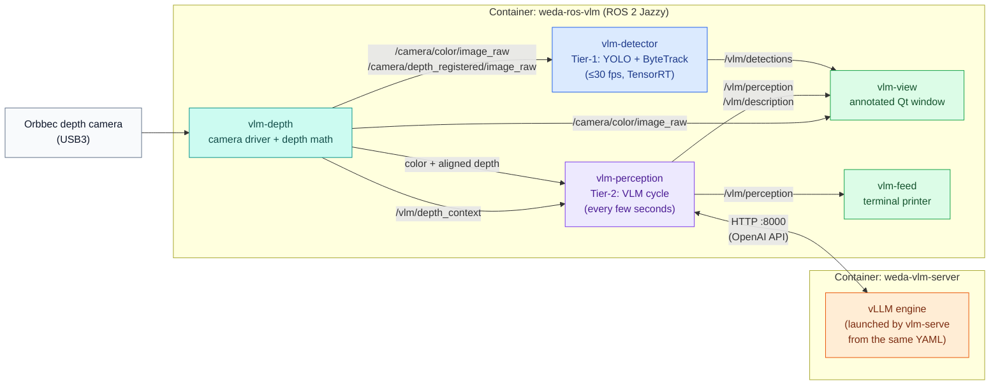

**How to read it:** teal is the camera driver, blue is the fast tier, purple is the smart tier, green is what you look at, orange is the GPU engine in thesecond container. Every arrow label is a real topic name you can `ros2 topic echo` right now — the diagram *is* the wiring, not a metaphor.

Not drawn to keep the diagram readable: `/camera/color/camera_info` and
`/vlm/depth_colormap/compressed` serve rviz and depth tooling, and
`/vlm/annotated/compressed` feeds rviz's annotated panel (it also becomes the viewer's frame source in RGB-only mode — see Section 1.5).

**Two-tier design in one sentence:** the detector tier owns *real-time geometry* (where things are, tracked IDs, measured distance, ≤30 fps); the VLM tier owns *meaning* (what the scene is, visible text, actions, every few seconds); the viewer fuses them by box overlap. Depth is **measured, never trusted** — the VLM's distance guesses are checked against the depth map.

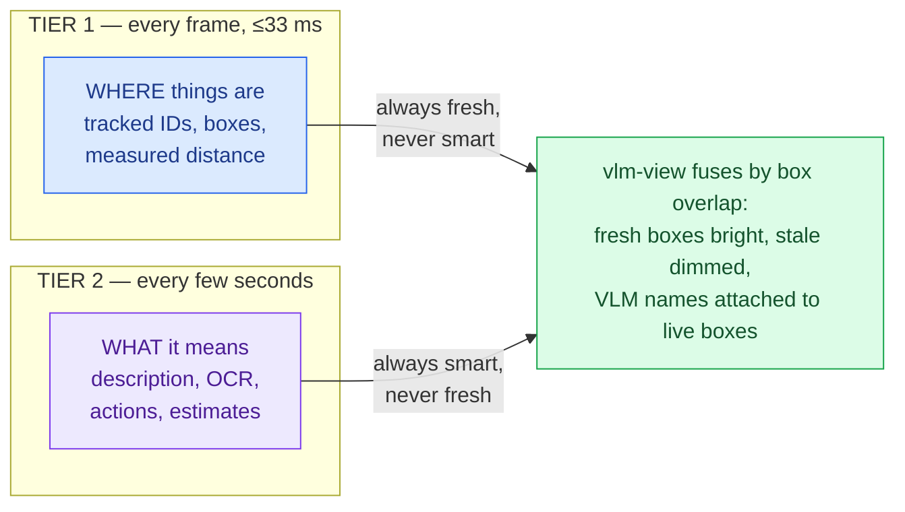

### 1.1 The nodes

| Executable (`ros2 run vlm_perception …`) | ROS node name | Source file | Role |
|---|---|---|---|
| `vlm-depth` | `vlm_depth_processor` | `depth_processor.py` | The camera driver. Talks to the Orbbec over `pyorbbecsdk`, software-aligns depth to color, publishes raw color/depth/intrinsics at camera rate plus the throttled depth-context grid and colormap. The top of the file is **pure math functions** (no ROS) reused by every other node. |
| `vlm-detector` | `vlm_detector` | `detector_node.py` | Tier-1 real-time detection: YOLO (TensorRT engine, exported on-device on first run) + ByteTrack persistent IDs, with a live measured distance per box. Idles gracefully (WARN, not crash) when the licensed detector package is not installed. |
| `vlm-perception` | `vlm_perception` | `app.py` | Tier-2 VLM cycle: latest frame (+ depth context text) → prompt → vLLM server (streaming) → parsed JSON → perception/description/annotated topics. Measures each returned box against the depth map. |
| `vlm-view` | `vlm_view` | `view.py` | The annotated Qt window: live camera frames at ~30 fps with detector boxes, VLM boxes, distances, and the full description + OCR banner. `q`/`Esc` close, `f` fullscreen. Requires a DISPLAY. |
| `vlm-feed` | `vlm_feed` | `feed.py` | Terminal pretty-printer for the perception payloads (exists because `ros2 topic echo` truncates long strings). |
| `vlm-serve` | *(not a ROS node)* | `serve_vlm.py` | ROS-free vLLM launcher: reads the `server:` YAML section, assembles and `exec`s the `vllm serve` command. Run inside the **server** container by docker-compose — never by the launch file. `--dry-run` prints the exact command and exits. |

Two support processes are started by the launch file alongside the nodes: a pair of `tf2_ros static_transform_publisher`s mapping `camera_link` to thecolor/depth optical frames (the standard optical rotation, so rviz shows the scene upright).

> **Naming rule:** executables are **hyphenated** (`vlm-depth`), node names
> are **underscored** (`vlm_depth_processor`). `ros2 run vlm_perception
> vlm_depth` fails — always use the hyphenated name with `ros2 run`.

### 1.2 The topics

Topic names all come from `config/vlm_app.yaml` — the table shows the shipped values. Nothing in the code hardcodes a wire name.

| Topic | Type | Publisher → subscribers | Rate | Content |
|---|---|---|---|---|
| `/camera/color/image_raw` | `sensor_msgs/Image` (bgr8) | vlm-depth → detector, perception, view | camera rate | live color frames |
| `/camera/depth_registered/image_raw` | `sensor_msgs/Image` (16UC1, **millimeters**) | vlm-depth → detector, perception | camera rate | depth **aligned to color** — same pixel grid as the color image |
| `/camera/color/camera_info` | `sensor_msgs/CameraInfo` | vlm-depth → (rviz, depth tools) | camera rate | real RGB intrinsics from the camera |
| `/vlm/depth_context` | `std_msgs/String` (JSON) | vlm-depth → perception | 2 Hz (throttled) | scene depth stats + 3×3 grid of median distances; injected into the VLM prompt as text |
| `/vlm/depth_colormap/compressed` | `sensor_msgs/CompressedImage` | vlm-depth → rviz (opt. perception) | 2 Hz | JET-colored depth for display; optionally sent to the VLM as a second image |
| `/vlm/detections` | `std_msgs/String` (JSON) | vlm-detector → view (yours too) | ≤30 Hz | tracked objects with IDs, class, confidence, box, measured distance |
| `/vlm/perception` | `std_msgs/String` (JSON) | vlm-perception → view, feed (yours too) | per VLM cycle | the full structured result (schema below) |
| `/vlm/description` | `std_msgs/String` (text) | vlm-perception → view | up to 2× per cycle | clean human text only; published **early** the moment the description field completes in the stream, again after full parse |
| `/vlm/annotated/compressed` | `sensor_msgs/CompressedImage` | vlm-perception → rviz | per VLM cycle | the frame the VLM saw, with boxes + caption burned in |

**QoS conventions** (follow these when you add nodes):

- Image subscriptions use `qos_profile_sensor_data` (best-effort — drop old frames, never lag).
- `vlm-depth` deliberately **publishes** its images RELIABLE/depth-10 so both best-effort subscribers (rviz, the app nodes) and reliable-only consumers (`depth_image_proc`) can connect.
- Two publishers are best-effort (`qos_profile_sensor_data`): the depth colormap and `/vlm/annotated/compressed`. A default-QoS (reliable)  subscriber silently receives nothing from either — subscribe them with the sensor-data profile.
- All JSON `String` topics use plain depth-10 (reliable) pub and sub.

### 1.3 The payload contracts

Everything app-level is **JSON in a `std_msgs/String`** — trivially consumable from any language, inspectable with `vlm-feed`, no custom message packages to version. Your nodes should follow the same convention.

`/vlm/detections` (Tier-1, real-time):

```json
{"ts": 1753791234.1, "fps": 29.7,
 "objects": [{"id": 3, "cls": "person", "conf": 0.91,
              "box_2d": [412, 96, 705, 998],
              "measured_distance_m": 1.42}]}
```

`/vlm/perception` (Tier-2, per cycle):

```json
{"parse_ok": true, "ts": 1753791234.5, "latency_ms": 2790,
 "model": "weda-vlm", "depth_context": "ok", "frame_age_s": 0.1,
 "description": "A worker holds a labeled cardboard box near the bench...",
 "visible_text": ["FRAGILE", "THIS SIDE UP"],
 "actions": ["holding a box"],
 "objects": [{"name": "cardboard box", "box_2d": [220, 180, 640, 760],
              "bearing": "center", "approx_distance_m": 1.5,
              "measured_distance_m": 0.93,
              "distance_check": "disputed (vlm 1.5 vs measured 0.93)"}]}
```

On failure the payload is still published, loudly: `parse_ok: false` with the
raw reply, or `status: server_unreachable / empty_reply / reasoning_truncated`
plus an `error` string. **Nothing is ever dropped silently.**

`/vlm/depth_context`:

```json
{"valid": true, "range_m": [0.31, 4.87], "mean_m": 2.1, "center_m": 0.94,
 "grid_median_m": [[3.1, 2.8, 3.0], [1.2, 0.9, 2.2], [0.8, 0.7, 1.9]],
 "pct_closer_than_1.0m": 22.4}
```

(The last key is dynamic — it tracks `depth.near_threshold_m`. Don't hardcode
it in consumers.)

**The canonical box space — the one contract every tier shares:** all `box_2d` values are `[x1, y1, x2, y2]` integers in **0–1000 normalized coordinates** of the frame (not pixels). The detector emits them that way, the VLM's replies are normalized into that space (`canonicalize_box`), the depth measurement consumes that space, and the viewer scales by `value/1000 × width_or_height` at draw time. Keep any box you publish in this space and every existing consumer understands it.

One picture of why that matters — three producers, three consumers, and none of them ever needs to know the frame resolution the others used:

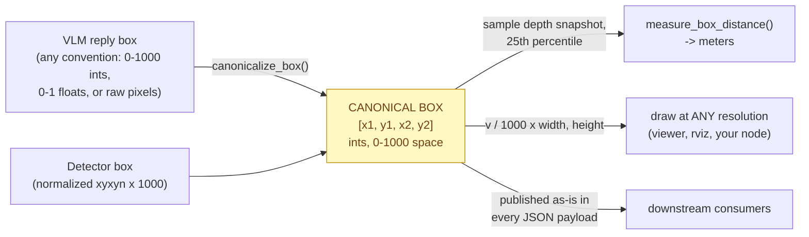

### 1.4 One perception cycle, step by step

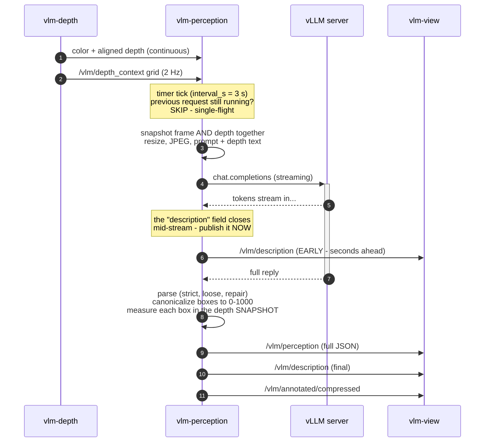

Why the two subtle moves matter: the **snapshot** (step 4) pairs the depth map with the exact frame the model will see, so a measurement never mixes two moments in time; the **early publish** (step 8) puts text on screen seconds before box grounding finishes — perceived latency drops for free.

The same cycle in prose:

1. `vlm-depth` continuously publishes color + aligned depth; every 0.5 s it also publishes the depth-context grid.
2. `vlm-perception`'s timer ticks (config `perception.interval_s`, shipped 3 s) — but **single-flight**: if a request is still running, the tick is skipped, so the effective cycle is "as fast as the model can go".
3. The node snapshots the latest color frame *and* the latest raw depth (so grounding later measures the scene the model actually saw), resizes to `client.max_image_edge`, JPEG-encodes, and builds the prompt: your `perception.prompt` + the depth-context block (or its `unavailable`/`stale` status — stale depth is never fed to the model).
4. The request streams from the vLLM server. The moment the top-level `"description"` field closes in the stream, the text is published on `/vlm/description` — that's the **early channel**, seconds before the full reply finishes.
5. The full reply is parsed (strict JSON → loose extraction → truncation repair; reasoning `<think>` blocks stripped when the model profile says so). Each returned `box_2d` is canonicalized to 0–1000 and measured against the depth snapshot (25th percentile of valid pixels inside the box, quality-gated). The VLM's own distance estimate is kept beside the measurement and flagged when they disagree by more than `depth.distance_tolerance_pct`.
6. The payload goes out on `/vlm/perception`, the clean description on `/vlm/description` (again), the annotated JPEG on `/vlm/annotated/compressed`.
7. Meanwhile `vlm-detector` has been publishing tracked boxes the whole time; `vlm-view` overlays both tiers, matching detector boxes to VLM object names by IoU, aging VLM boxes (bright <4 s, dimmed+`[stale]` <10 s, gone after), and showing the newest description in the banner.

### 1.5 Running without the depth camera (RGB-only mode)

The pipeline does not require any hardware. Set `depth.enabled: false` in the config and `vlm-perception` stops subscribing to ROS image topics and captures frames itself in a GStreamer thread from `stream.gst_pipeline`. The shipped default pipeline is a synthetic `videotestsrc` test pattern — zero hardware attached; USB-webcam (`v4l2src`), RTSP, and video-file variants are commented in the config. Two rules from the `stream:` section comments: the pipeline must end with `appsink drop=true max-buffers=1 sync=false` (latest-frame-wins — no latency creep), except file playback which uses `sync=true` to pace like a live camera.

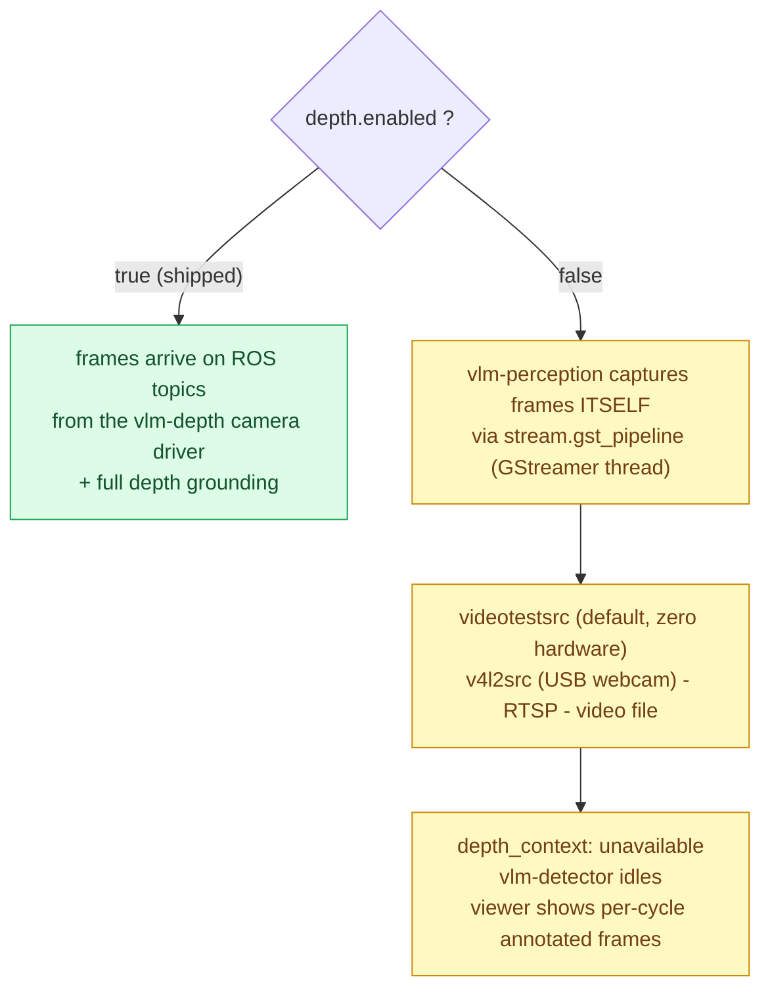

In this mode `vlm-depth` and `vlm-detector` are not useful (`vlm-detector` explicitly idles — it needs the camera driver), payloads carry `depth_context: "unavailable"`, and `vlm-view` falls back to `/vlm/annotated/compressed` as its frame source, so its window updates once per VLM cycle instead of at camera rate. Description, OCR, and boxes all keep working — this is the fastest way to develop VLM-side features on a desk with no camera.

---

## 2. How the workspace functions

### 2.1 Where things live

| Host path (this bundle) | In-container path | Mode | What it is |
|---|---|---|---|
| `weda_ws/` | `/opt/weda_ws` | rw | **your colcon workspace** — packages under `src/`, build artifacts, exported TensorRT engines (`models/`), bench reports (`reports/`). Persists across container recreation. |
| `.` (bundle root) | `/opt/weda-release` | **ro** | config, launch script, rviz preset, tests. Read-only by design: edit these files **on the host**. |
| `config/vlm_app.yaml` | `/opt/weda-release/config/vlm_app.yaml` | ro | THE configuration file — server and all nodes read this same file. |

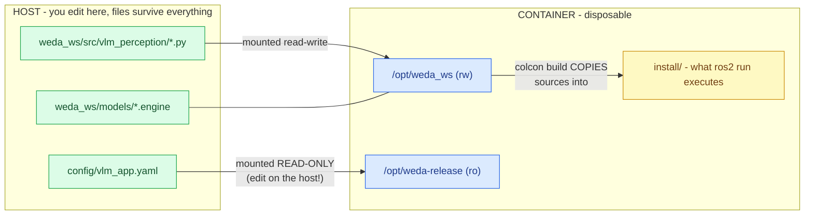

The yellow box is the one that bites newcomers: `ros2 run` executes the **copy** in `install/`, not your edited file — which is exactly why the next section's rebuild rule exists.

### 2.2 The build lifecycle

- **First container start:** the entrypoint builds the workspace once  (`colcon build --symlink-install`), self-healing stale state (on failure it  wipes `build/ install/ log/` and retries once). You never run this step.
- **After you edit source:** this colcon setup **copies** Python modules into  `install/` — an edit does *not* take effect until a rebuild. Two ways:
  - `./build.sh --demo` — the demo launcher detects sources newer than
    `install/setup.bash` and rebuilds automatically before launching.
  - Manually, inside a shell: `cd /opt/weda_ws && colcon build && source
    install/setup.bash`.
- **Sourcing:** a plain `docker exec` shell is *unsourced*. Use
  `./build.sh --shell`, which sources the ROS underlay and the workspace overlay for you.

Who rebuilds, and when:

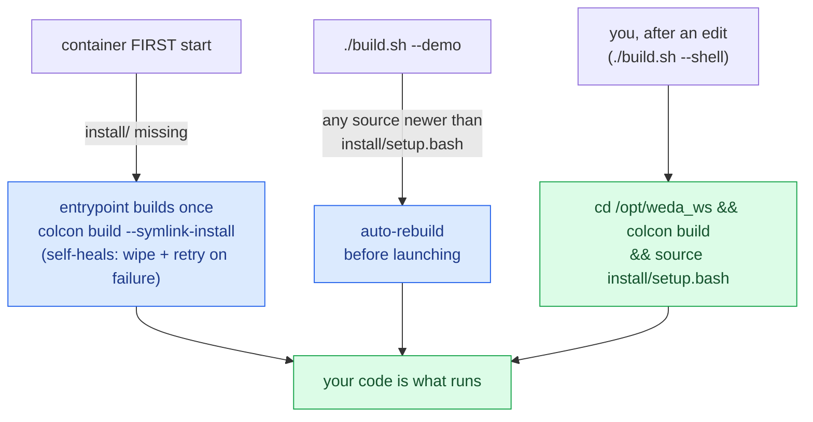

### 2.3 Configuration resolution

Every node takes `-c/--config`; the default is the `VLM_APP_CONFIG` env var, falling back to `/opt/weda-release/config/vlm_app.yaml`. Precedence:

```
--config flag  >  VLM_APP_CONFIG env  >  /opt/weda-release/config/vlm_app.yaml
```

`load_config()` (in `common.py`) does `${VAR}` environment interpolation overthe whole file (secrets stay in `.env`, e.g. `${CAM_PASS}`) and fails loudlyif any of the six required sections is missing: `server, client, stream,perception, depth, output`. Sections you add for your own nodes are **optional** — read them with `cfg.get("yoursection") or {}`.

The config is passed to nodes as a **CLI argument** (the launch file uses `arguments=['--config', …]`), not as ROS parameters — one file, one parse, identical values everywhere, including the server container.

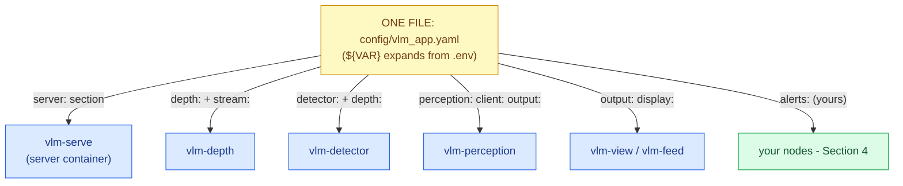

One parse, identical values everywhere — a tuning change, a topic rename, or a model swap is always a one-file diff you can code-review.

### 2.4 The development loop

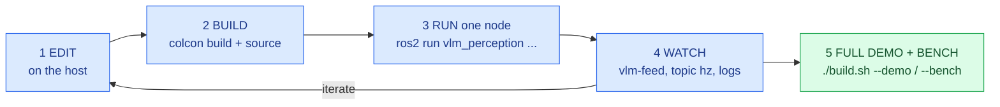

```bash
# 1. Edit source on the HOST (any editor):
#    weda_ws/src/vlm_perception/vlm_perception/...

# 2. Get a sourced shell in the container:
./build.sh --shell

# 3. Rebuild + reload:
cd /opt/weda_ws && colcon build && source install/setup.bash

# 4. Run just the node you're working on:
ros2 run vlm_perception vlm-perception          # or vlm-depth / vlm-detector...

# 5. Watch it:
ros2 topic list
ros2 run vlm_perception vlm-feed                # full payloads, not truncated
ros2 topic hz /vlm/detections

# 6. When done, the full demo (auto-rebuilds if needed):
exit && ./build.sh --demo

# 7. Regression-check the whole deployment (WISE-Bench, the bundle's
#    scored verification suite; reports land in weda_ws/reports/):
./build.sh --bench
```

The launch file starts the three pipeline nodes + static TFs:

```bash
ros2 launch vlm_perception perception.launch.py                 # default config
ros2 launch vlm_perception perception.launch.py config:=/path/to/other.yaml
```

`vlm-view` and `vlm-feed` are *not* in the launch file — the demo script starts them based on display availability **and** the config's `display:` toggles (all three ship enabled; `vlm-feed` takes over whenever the viewer window is not shown — e.g. headless). During development you start them by hand.

**Where logs go:** launch-file nodes use `output=screen`, so their WARN/ERROR lines appear in the terminal that ran the launch (the demo terminal); the static TF publishers log to file only. File logs land under `/opt/weda_ws/log` (colcon build logs) and `~/.ros/log` (node logs). From the host,
`./build.sh --logs` tails the container output.

---

## 3. Design rules the code follows (copy these in your nodes)

1. **Latest-wins mailboxes, never queues.** Every callback overwrites one slot (`self._frame`, `self._depth`, …) under a single `threading.Lock`; consumers snapshot under the same lock. A slow consumer never builds lag.
2. **Single-flight long work.** One VLM request in flight, ever. A busy tick is skipped; the freshest frame wins. Never do slow work inside a callback.
3. **Pure functions above the node class.** All depth math (`compute_depth_context`, `colorize_depth`, `canonicalize_box`, `measure_box_distance` in `depth_processor.py`) is ROS-free, takes numpy arrays in **float32 meters**, and signals failure explicitly — `canonicalize_box`/`measure_box_distance` return `None`, `compute_depth_context` returns `{"valid": false}`. That's what makes it unit-testable (WISE-Bench exercises exactly these) and reusable from every node. Keep your algorithms in this shape.
4. **The wire is uint16 millimeters; the math is float32 meters.** Convert once at the boundary: `depth_m = raw.astype(np.float32) * depth.depth_scale` when the image is uint16; float32 images pass through as meters. Feeding raw uint16 into the pure functions yields garbage.
5. **Fail loud, stay alive.** A missing camera, an unreachable server, an unparseable reply — each produces a WARN and an explicit marker in the payload (`status`, `parse_ok: false`, `depth_context: unavailable`), and the node keeps running. Optional fields (like `measured_distance_m`) are *absent* when unavailable — consumers must treat them as optional.
6. **Guarded commercial imports (BYOL — bring your own license).** Commercially licensed packages install at container start after EULA acceptance, never baked into the image. The detector does `try: from ultralytics import YOLO / except ImportError` at module level, warns once with the remedy (`ACCEPT_COMMERCIAL_EULA=true` in `.env`, restart), and idles. A missing license is never a crash.
7. **Topic names come from the config.** No wire name is hardcoded — your node reads its topics from the YAML with sensible defaults.
8. **ROS args pass through.** Use `argparse ... parse_known_args()` and hand the remainder to `rclpy.init(args=ros_args)` so `--ros-args` remapping keeps working.

Rules 1 and 2 are the heart of why this pipeline never lags, so here they are as a picture — every node in the package is some arrangement of these two shapes:

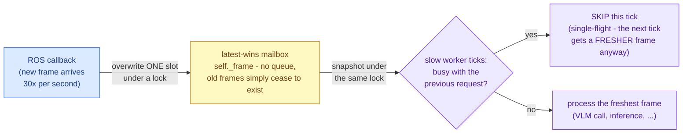

The payoff: a 3-second VLM request and a 30 fps camera coexist with **zero queue growth and zero stale processing** — the slow side always works on the newest reality, and the fast side never waits.

---

## 4. Worked example — add a new node, end to end

Goal: a **proximity + keyword alert node**. It watches both tiers — alerts when a tracked person comes closer than 1 m (real-time, measured), or when a watch word ("smoke", "spill", …) appears in the VLM's description — and publishes JSON alerts on `/vlm/alerts` with a cooldown. It touches every integration point you'll need for your own features, and it works with the pipeline exactly as shipped.

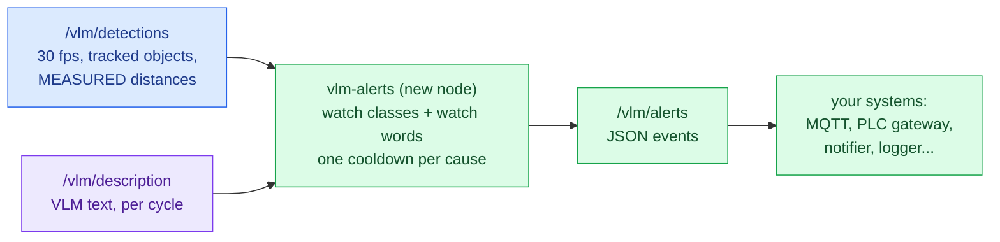

Notice it listens to **both tiers**: the fast tier for a *measured* proximity fact (never the VLM's guess), the smart tier for semantic events no detector class could express. That pairing is the house pattern for reactive features.

### Step 1 — the node

Create `weda_ws/src/vlm_perception/vlm_perception/alerts.py` (on the host):

```python
"""Proximity + keyword alerts — the reference 'add your own node' example.

Tier-1: watched class closer than alerts.distance_m  -> {"type": "proximity"}
Tier-2: watch word in the VLM description            -> {"type": "keyword"}
Published as JSON on /vlm/alerts, at most once per cooldown per cause.
"""
import argparse
import json
import time

import rclpy
from rclpy.node import Node
from std_msgs.msg import String

from vlm_perception.common import DEFAULT_CONFIG, load_config


class AlertNode(Node):
    def __init__(self, cfg: dict):
        super().__init__("vlm_alerts")
        a = cfg.get("alerts") or {}          # OPTIONAL section — see 2.3
        self._classes = set(a.get("watch_classes", ["person"]))
        self._near_m = float(a.get("distance_m", 1.0))
        self._words = [w.lower() for w in a.get("watch_words", [])]
        self._cooldown = float(a.get("cooldown_s", 10.0))
        self._last = {}                      # alert key -> last emit time

        self._pub = self.create_publisher(String, a.get("topic", "/vlm/alerts"), 10)
        det_topic = (cfg.get("detector") or {}).get("publish_topic", "/vlm/detections")
        self.create_subscription(String, det_topic, self._on_detections, 10)
        self.create_subscription(String, cfg["output"]["description_topic"],
                                 self._on_description, 10)
        self.get_logger().info(
            f"watching {sorted(self._classes)} < {self._near_m}m; words={self._words}")

    def _emit(self, key: str, payload: dict) -> None:
        now = time.time()
        if now - self._last.get(key, 0.0) < self._cooldown:
            return
        self._last[key] = now
        payload["ts"] = now
        self._pub.publish(String(data=json.dumps(payload)))
        self.get_logger().warning(f"ALERT {payload}")

    def _on_detections(self, msg: String) -> None:
        try:
            objects = json.loads(msg.data).get("objects", [])
        except ValueError:
            return                            # malformed frame: skip, never crash
        for o in objects:
            dist = o.get("measured_distance_m")   # optional field — rule 5
            if o.get("cls") in self._classes and dist is not None and dist < self._near_m:
                self._emit(f"prox:{o.get('id')}",
                           {"type": "proximity", "cls": o["cls"],
                            "track_id": o.get("id"), "measured_distance_m": dist})

    def _on_description(self, msg: String) -> None:
        text = msg.data.lower()
        for w in self._words:
            if w in text:
                self._emit(f"word:{w}",
                           {"type": "keyword", "word": w, "description": msg.data})


def main() -> None:
    ap = argparse.ArgumentParser()
    ap.add_argument("-c", "--config", default=DEFAULT_CONFIG)
    args, ros_args = ap.parse_known_args()    # ROS args pass through — rule 8
    rclpy.init(args=ros_args)
    node = AlertNode(load_config(args.config))
    try:
        rclpy.spin(node)
    except KeyboardInterrupt:
        pass
    finally:
        node.destroy_node()
        if rclpy.ok():
            rclpy.shutdown()


if __name__ == "__main__":
    main()
```

Note what it did **not** need: no custom message package (JSON in String), no
ROS parameters (the shared YAML), no queues or threads (its work is fast, so
plain callbacks suffice; see `detector_node.py` for the worker-thread pattern
when work is slow).

### Step 2 — register the executable

In `setup.py`, add one line to `console_scripts` (keep the hyphenated naming):

```python
            "vlm-alerts = vlm_perception.alerts:main",
```

### Step 3 — configure it

Add an optional section to `config/vlm_app.yaml` **on the host** (the file is
mounted read-only in the container):

```yaml
alerts:                        # consumed by the vlm-alerts example node
  topic: /vlm/alerts
  watch_classes: [person]      # detector class names (COCO)
  distance_m: 1.0              # Tier-1: alert below this measured distance
  watch_words: [smoke, spill]  # Tier-2: alert when these appear in descriptions
  cooldown_s: 10.0             # min seconds between repeats of the same alert
```

### Step 4 — build and test it alone

```bash
./build.sh --shell
cd /opt/weda_ws && colcon build && source install/setup.bash
ros2 run vlm_perception vlm-alerts        # terminal 1 (or add & for background)
```

In a second shell (`./build.sh --shell` again):

```bash
ros2 topic echo /vlm/alerts               # walk toward the camera → proximity alert
```

You can test it with **no pipeline running** by faking a detection:

```bash
ros2 topic pub --once /vlm/detections std_msgs/String \
  "{data: '{\"objects\": [{\"id\": 1, \"cls\": \"person\", \"measured_distance_m\": 0.5}]}'}"
```

### Step 5 — make it part of the pipeline

Add it to `launch/perception.launch.py` next to the existing nodes:

```python
        Node(
            package="vlm_perception",
            executable="vlm-alerts",
            name="vlm_alerts",
            output="screen",
            arguments=["--config", config],
        ),
```

From now on `./build.sh --demo` rebuilds and launches it with everything else, and `ros2 topic echo /vlm/alerts` (or any downstream system — MQTT bridge, PLC gateway, notifier) consumes it.

That's the whole recipe: **one file, one `setup.py` line, one optional config section, one launch entry.** Every node in this package was added exactly the same way.

---

## 5. Extension recipes — changing each part of the pipeline

| You want to… | Where | How |
|---|---|---|
| Change what the VLM looks for / reports | `config/vlm_app.yaml` → `perception.prompt` | Edit the prompt text and its JSON schema — **no code**. Add a field to the schema and it appears in `/vlm/perception` payloads automatically (unknown fields pass through the parser). Raise `perception.max_tokens` if you ask for more. |
| Swap the VLM model | `server:` + `model_profile:` sections | 3-line recipe: `server.model`, `kv_cache_dtype: auto`, `attention_backend: null`; then pin `model_profile.box_format` if the new family emits pixel boxes. Then `docker restart weda-vlm-server` — the YAML is read once at engine start, and a plain `./build.sh --server` on an already-running server is a no-op. The client adapts; capabilities a model lacks degrade to skipped fields, never wrong values. Verified model families: see "Model swapping" in the bundle README. |
| React to results (alarms, PLC, MQTT…) | new node | Subscribe `/vlm/perception` or `/vlm/detections` (JSON in String) — Section 4 is exactly this. |
| Trigger the VLM on *events* instead of a timer | `app.py` | Subscribe `/vlm/detections` in `VlmPerceptionNode`, fire `_tick` when a new track ID appears instead of / as well as the timer. Zero GPU spent describing an unchanged scene. |
| Only analyze a region of interest | `app.py` | Crop the frame before the JPEG encode in the tick; keep publishing the full frame for the viewer. Remember: boxes come back relative to what you *sent*. |
| Feed a different camera | `DEPTH_CAMERA.md` (bundle root) | Vendor ROS driver + `depth:` topic names (Option A, config-only), or adapt `vlm-depth` into a relay (Option B). Consumers never change: they handle both 16UC1-mm and 32FC1-m encodings. |
| Change detector model / classes | `detector:` section | `detector.model` (a `.engine` path exports on-device from the sibling `.pt` on first run), `detector.classes`, `conf`, `max_fps`, `imgsz`. Custom weights: put `myname.pt` next to the configured `myname.engine` path. |
| Add another display window | new node | Copy the `view.py` skeleton: rclpy spin in a daemon thread, Qt on the main thread, latest-wins slots + `snapshot()`. (Qt, not `cv2.imshow` — OpenCV's GTK GUI aborts in this container.) |
| Reuse the depth math anywhere | `depth_processor.py` | `from vlm_perception.depth_processor import measure_box_distance, compute_depth_context, …` — pure functions, no node needed. Feed them float32 **meters**. |
| Ship a second app alongside | new package | `ros2 pkg create --build-type ament_python my_app` under `weda_ws/src/` — the workspace builds every package it finds. Copy `common.py` for the config contract, or depend on `vlm_perception` and import it. |
| Pass a different config per run | any node / launch | `ros2 run vlm_perception vlm-perception -c /path/to/variant.yaml`, `ros2 launch vlm_perception perception.launch.py config:=/path/…`, or export `VLM_APP_CONFIG`. |

### Converting a detector `.pt` to a TensorRT engine

You normally never do this by hand — it is **automatic**. The config points at an engine path (`detector.model: /opt/weda_ws/models/yolo26n.engine`); if that file is missing on startup, the detector exports it once from the matching `.pt` (the sibling file next to the engine path for custom weights, or the official model auto-downloaded by name), FP16, ~3 minutes, persisted in the workspace so every later start is instant. If the export fails, the node falls back to running the `.pt` directly — slower, never a crash.

To convert manually (inside the container, EULA accepted — the exporter is part of the licensed detector package):

```bash
./build.sh --shell
python3 -c "from ultralytics import YOLO; \
YOLO('/opt/weda_ws/models/yolo26n.pt').export(format='engine', imgsz=640, half=True, device=0)"
```

or the CLI equivalent:

```bash
yolo export model=/opt/weda_ws/models/yolo26n.pt format=engine imgsz=640 half=True device=0
```

The `.engine` lands next to the `.pt` (an intermediate `.onnx` is emitted
too). Point `detector.model` at it and restart the pipeline.

The rules that make conversions work every time:

- **`imgsz` at export must equal `detector.imgsz` at runtime** (both default 640) — a mismatch fails at inference, not at export.
- **Engines are device- and TensorRT-version-specific.** Never copy one between different devices and never commit one — build it where it runs (this is exactly why the config points at an `.engine` that exports on-device instead of shipping one).
- **Custom weights follow the sibling contract:** put `my_model.pt` next to the configured `my_model.engine` path. Never configure a bare custom name — it would be treated as an official model to download.
- **A corrupt engine (interrupted export, different silicon) is self-healing:** the node falls back to the `.pt` and tells you; delete the bad `.engine` to trigger a fresh export.

**Rules of the road when extending:**

- New config sections are optional (`cfg.get(...) or {}`); never grow `load_config`'s required list for an add-on feature.
- Publish JSON in `std_msgs/String` for app-level data; keep `box_2d` in the canonical 0–1000 space.
- The bundle mount is read-only — all editing happens on the host; only `/opt/weda_ws` is writable from inside.
- The server container starts `serve_vlm.py` **by file path before the workspace is built** — that file must stay importable on its own (it deliberately inlines the `${VAR}` interpolation rather than importing `common.py`; if you change one, mirror the other).
- After any change: `./build.sh --bench` — WISE-Bench's application tier (T3 in the report) imports every module, checks the launch file, and  unit-tests the depth math; a red bench tells you exactly which contract  you broke. Reports land in `weda_ws/reports/`.

---

## 6. Why these server settings (Thor tuning rationale)

| Setting | Why |
|---|---|
| `gpu_memory_utilization: 0.30` | Jetson **unified memory**: this is a fraction of TOTAL RAM that must be actually FREE at engine start. 0.30 boots on a busy box; raise toward 0.45 on a dedicated device for KV headroom. The 0.9 datacenter default would starve ROS/CV/OS. |
| `kv_cache_dtype: fp8` | Halves KV-cache traffic per decode step; validated near-baseline accuracy for Qwen3-VL. Set `auto` when swapping model families. |
| `attention_backend: flashinfer` | Thor-optimized attention kernels in this stack (Qwen3-VL-validated; `null` for other families). |
| no `enforce_eager` | CUDA graphs ON ≈ 7× decode throughput on Jetson for ~1 GB of memory. Enable `enforce_eager` only to debug. |
| `enable_chunked_prefill` + `max_num_batched_tokens: 8192` | Image prompts prefill in chunks — decode stays smooth under load. |
| `enable_prefix_caching` | The system prompt repeats every cycle — its KV is computed once. |
| `speculative_config` (ngram) | Model-agnostic speculative decoding — drafts token spans from the prompt itself; no draft model, no extra memory. |
| `mm_processor_cache_gb: 0` | Camera frames never repeat; the default multimodal cache would never hit. |
| `max_pixels: 1003520` | Caps visual tokens per frame (~980). Applies to Qwen/GLM/Ernie processors only — the launcher warns and skips it for other families. |
| `quantization: null` (auto-detect) | vLLM detects `awq_marlin` from the AWQ checkpoint itself — int4 W4A16 fits the 30B MoE in ~17 GB on the Thor-tuned fused-MoE kernels. `null` survives model swaps; pin a value only to override detection. |

`server.extra_args` is the escape hatch for any vLLM flag not modeled above.

## 7. Failure behavior (by design, all loud)

| Situation | What you see |
|---|---|
| vLLM server down / still loading | `{"status": "server_unreachable"}` on `/vlm/perception`, throttled WARN, capture keeps running |
| Model reply not JSON | `parse_ok: false` + raw text in the JSON payload — never silently coerced, never sent to `/vlm/description` |
| Reply truncated (`max_tokens`) | repaired if possible, marked `truncated`; raise `perception.max_tokens` |
| Camera unplugged / stream drop | capture reopen with 1→30 s backoff, `no frame yet` WARN |
| Depth driver not running | `depth_context: "unavailable"` in payloads; RGB-only continues |
| Depth older than `depth.max_context_age_s` | `depth_context: "stale (…)"`; per-object measurement skipped too — stale data is never used |
| VLM distance ≠ measured | `distance_check: "disputed (vlm X vs measured Y)"` per object — trust `measured_distance_m` |
| Licensed detector not accepted | detector idles with a single WARN naming the fix; every other feature runs |
| Box quality gate fails | `measured_distance_m` simply **absent** for that object |

Remedies for every symptom: `TROUBLESHOOTING.md` at the bundle root.

## 8. Node cheat sheet

```bash
ros2 run vlm_perception vlm-depth        # camera driver + depth context
ros2 run vlm_perception vlm-detector     # Tier-1 real-time detector
ros2 run vlm_perception vlm-perception   # Tier-2 VLM cycle
ros2 run vlm_perception vlm-view         # annotated window (needs DISPLAY)
ros2 run vlm_perception vlm-feed         # terminal payload printer
ros2 run vlm_perception vlm-serve -- --dry-run   # print the exact vllm command
ros2 launch vlm_perception perception.launch.py  # depth + detector + perception + TFs
```

All accept `-c/--config <path>`. The ROS nodes forward unknown args to ROS (so `--ros-args -r /vlm/alerts:=/factory/alerts` style remapping works); `vlm-serve` is not a ROS node and accepts only `-c/--config` and `--dry-run`.
